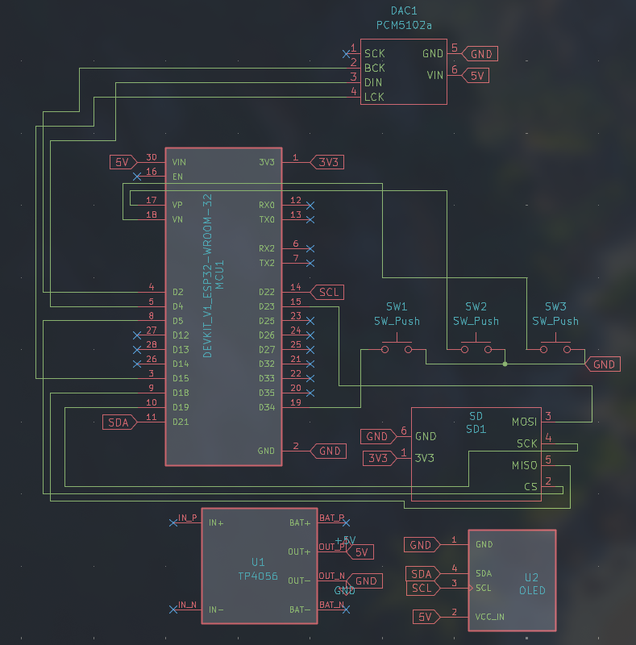
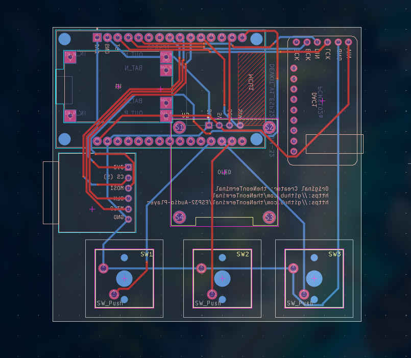
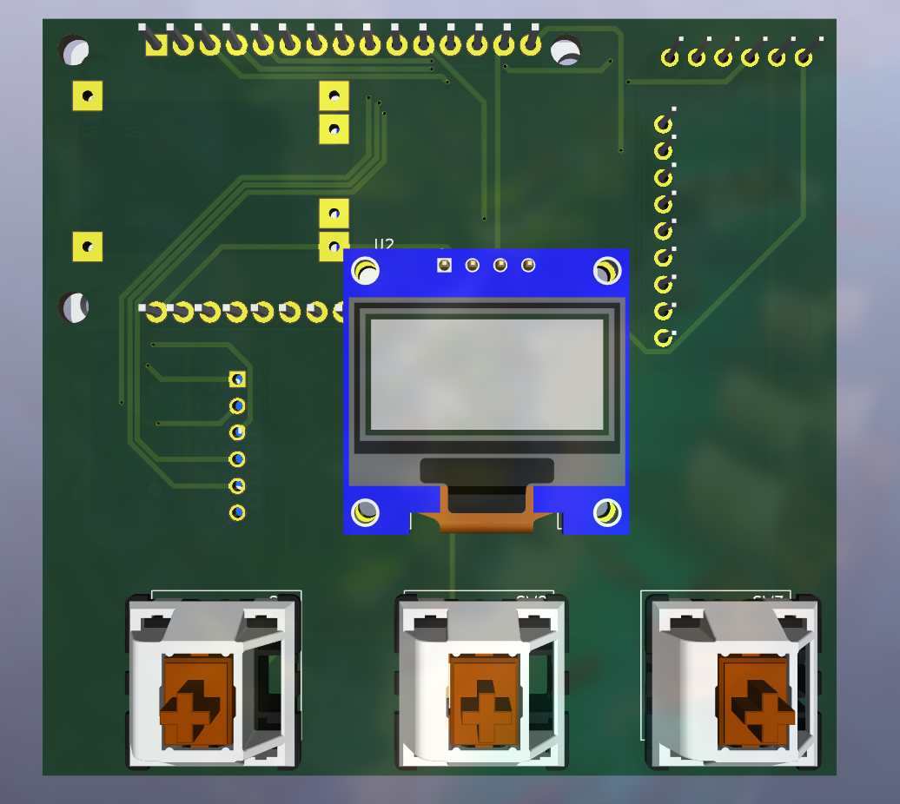
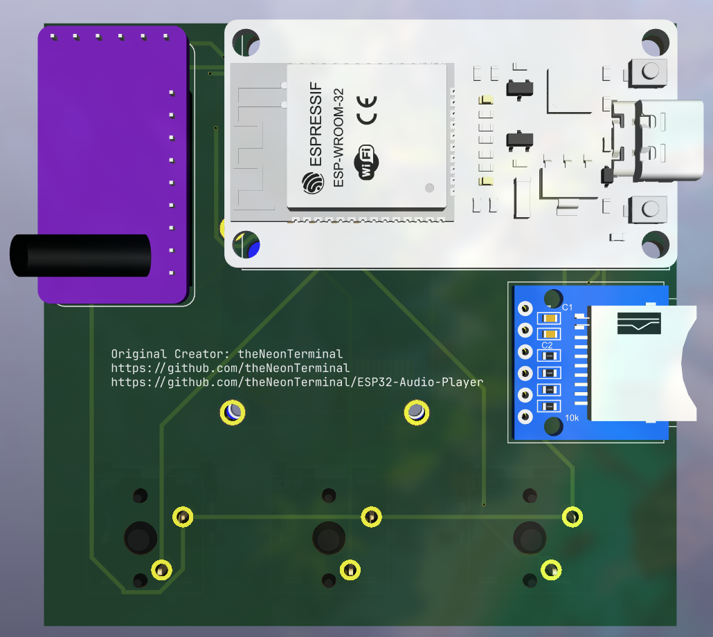

# ESP32 Based Audio Player

An ESP32 Based iPod type music player, can play music (`.mp3`) stored and given in an SD Card along with OLED display to show stats

  
---

## About this Project

An ESP32 (my favourite microcontroller) based music player - similar to an iPod, but DIY and made for a lot cheaper. Right now the current version of the firmware only includes wired headphones (via PCM5102a DAC module) but I plan to implement a Bluetooth A2DP sink and source so that it is different from a normal iPod.

## Hardware Design

### 01 / Circuit Schematic

### 02 / PCB Layout

### 03 / PCB 3D View

---

## Currently Implemented Features

* **Wired:** No wireless connectivity issues! No latency issues!
* **SD Card:** Update your SD card and it works without needing to update the firmware again.
* **OLED Feedback:** OLED display to show currently playing song and if it's paused or not.
* **Physical control buttons:** Control your sound using clicky Cherry MX Blue mechanical switches.

---

## BoM

| PART | QUANTITY | Purpose |
| ---- | -------- | ------- |
| ESP32 | 1 | Main Processing unit |
| PCM5102a | 1 | Main I2S DAC |
| SPI SD Card Reader | 1 | To read the SD Card |
| Professional PCB | 1 | To house the electronics |
| OLED SSD1306 | 1 | To display some stats about the song |
| Mechanical switches | 3 | For audio controls |

## Firmware Working

Dependencies:

* <a href="https://github.com/pschatzmann/arduino-audio-tools">https://github.com/pschatzmann/arduino-audio-tools</a> (arduino-audio-tools)
* <a href="https://github.com/pschatzmann/codec-helix">https://github.com/pschatzmann/codec-helix</a> (codec-helix)
* <a href="https://github.com/adafruit/adafruit-gfx-library">https://github.com/adafruit/adafruit-gfx-library</a> (adafruit-gfx-library)
* <a href="https://github.com/adafruit/adafruit_ssd1306">https://github.com/adafruit/adafruit_ssd1306</a> (adafruit_ssd1306)

This code runs a modified version of an <a href="https://github.com/pschatzmann/arduino-audio-tools/tree/main/examples/examples-player/player-sd-i2s">this</a> example code. I have added custom defined I2S and SPI pins (CS only for SPI) and added some graphics for OLED SSD1306 driver. I display the currently playing song on the OLED display and implement a simple logic to handle button presses to control the audio from the `player` class (please refer to arduino-audio-tools documentation for this) which include `next-track`, `previous-track` and pause (`isActive`)
